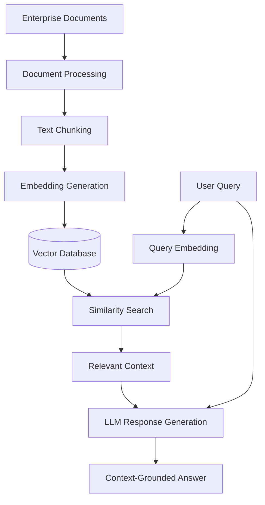

# Enterprise RAG Knowledge Assistant

An AI-powered knowledge retrieval system that leverages Retrieval-Augmented Generation (RAG), semantic search, and vector embeddings to retrieve contextually relevant information from enterprise knowledge sources.

## Overview

Traditional enterprise search systems often struggle with unstructured documents and semantic queries. This project implements a RAG pipeline that retrieves relevant document context using vector similarity search and uses that context to support LLM-generated responses.

**Project Status:** Working Prototype (Local Deployment)

## Key Features

- **Retrieval-Augmented Generation (RAG):** Grounds LLM responses in retrieved document context.
- **Semantic Search:** Uses embedding-based representations to identify contextually relevant information.
- **Vector Database:** Stores and retrieves document embeddings for similarity-based search.
- **Document Retrieval Pipeline:** Processes knowledge sources and retrieves relevant context for user queries.
- **Retrieval Evaluation:** Evaluates retrieval performance against a test dataset.

## Architecture



## Technology Stack

| Component | Technology |
|---|---|
| Programming Language | Python |
| AI Architecture | Retrieval-Augmented Generation |
| Embeddings | Embedding Models |
| Retrieval | Semantic / Vector Search |
| Storage | Vector Database |
| Deployment | Local Environment |

## Performance Evaluation

The current prototype has been evaluated for retrieval performance.

| Metric | Result |
|---|---:|
| Retrieval Accuracy | 92% |
| Vector Retrieval Latency | 1.8 ms |

*Latency represents the measured retrieval operation, not end-to-end LLM response generation. Results depend on the evaluation dataset and execution environment.*

## Getting Started

### Prerequisites

- Python 3.10+
- pip
- API access to the embedding model and LLM provider used by your implementation

### Installation

Clone the repository:

```bash
git clone <YOUR_REPOSITORY_URL>
cd enterprise-rag-knowledge-assistant
```

Create a virtual environment:

```bash
python -m venv .venv
```

Activate the environment:

**Linux / macOS**
```bash
source .venv/bin/activate
```

**Windows**
```bash
.venv\Scripts\activate
```

Install dependencies:

```bash
pip install -r requirements.txt
```

### Environment Configuration

Create a `.env` file:

```env
LLM_API_KEY=your_api_key
EMBEDDING_MODEL=your_embedding_model
VECTOR_DATABASE_PATH=your_database_path
```

Never commit API keys or credentials to version control.

### Run

```bash
python main.py
```

Replace the entry point and configuration variables with those used in your actual implementation.

## Project Structure

```text
enterprise-rag-knowledge-assistant/
│
├── data/
│   └── documents/
├── embeddings/
├── retrieval/
├── vector_store/
├── evaluation/
├── main.py
├── requirements.txt
├── .env.example
└── README.md
```

*Illustrative structure; adapt to the actual repository.*

## Future Improvements

- Introduce multi-agent orchestration using LangGraph.
- Implement ReAct-based tool calling and agent state management.
- Support hybrid retrieval combining vector search and keyword search.
- Integrate structured enterprise data sources alongside unstructured documents.
- Deploy services using Google Cloud Run and Vertex AI.
- Add evaluation pipelines for retrieval relevance, answer faithfulness, and groundedness.
- Implement observability for token consumption, query latency, and cost per request.

## Learning Objectives

- Designing Retrieval-Augmented Generation architectures.
- Building embedding-based semantic retrieval pipelines.
- Working with vector databases and document processing.
- Evaluating retrieval quality and system performance.
- Understanding the engineering challenges of taking AI prototypes toward production-grade enterprise systems.

## License

Add an appropriate open-source license before public distribution.
